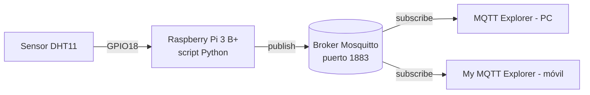

# Monitorización ambiental IoT con Raspberry Pi, DHT11 y MQTT

Sistema IoT que mide **temperatura y humedad** con un sensor DHT11 conectado a una **Raspberry Pi 3 Model B+** y publica las lecturas en tiempo real mediante **MQTT** (broker Eclipse Mosquitto) para consultarlas desde un PC o un móvil.

> Proyecto Fin de Ciclo · CFGS Sistemas de Telecomunicaciones e Informáticos · IES Fernández Vallín · 2024–2026
> Autora: **Nadia Valvidares González**

   

---

## Resumen

- Prototipo **funcional, fiable y de bajo coste** (≈ 74,60 €), 100 % software libre.
- La Raspberry Pi actúa a la vez como **nodo de adquisición** y como **broker MQTT**: no necesita servidores externos.
- Visualización con **MQTT Explorer** (PC) y **My MQTT Explorer** (móvil).

## Arquitectura



Topics utilizados:

| Topic | Contenido |
|---|---|
| `casa/habitacion1/temperatura` | Temperatura (°C) |
| `casa/habitacion1/humedad` | Humedad relativa (%) |
| `casa/habitacion1/#` | Comodín para suscribirse a ambos |

## Hardware

| Componente | Detalle |
|---|---|
| Raspberry Pi 3 Model B+ | Nodo central + broker |
| Sensor DHT11 | 0–50 °C (±2 °C) · 20–80 % HR (±5 %) |
| LED + resistencia 220–330 Ω | Prueba inicial de GPIO |
| Protoboard, jumpers, fuente 5 V, microSD | Montaje y alimentación |

### Conexión del DHT11

| Pin DHT11 | Función | Raspberry Pi |
|---|---|---|
| VCC | Alimentación 3,3 V | Pin físico 1 |
| DATA | Señal | GPIO18 (pin físico 12) |
| GND | Tierra | Pin físico 14 |

## Estructura del repositorio

```
├── src/
│   ├── led_test.py              # Prueba de GPIO con un LED
│   ├── dht11_read.py            # Lectura del sensor por consola
│   ├── dht11_mqtt_publisher.py  # Lectura + publicación MQTT (script principal)
│   └── mqtt_subscriber.py       # Suscriptor para PC
├── config/
│   └── mosquitto.conf.example   # Configuración del broker
├── docs/                        # Memoria y resumen del proyecto (PDF)
├── images/                      # Fotos del montaje y capturas
├── requirements.txt
└── LICENSE
```

## Puesta en marcha

### 1. Broker MQTT en la Raspberry Pi

```bash
sudo apt-get update
sudo apt-get install mosquitto mosquitto-clients
sudo systemctl enable mosquitto.service
```

Añade en `/etc/mosquitto/mosquitto.conf` (ver `config/mosquitto.conf.example`):

```
listener 1883 0.0.0.0
allow_anonymous true
```

```bash
sudo systemctl restart mosquitto
```

### 2. Entorno Python

```bash
python3 -m venv dht-env
source dht-env/bin/activate
pip install -r requirements.txt
```

### 3. Ejecutar el publicador

```bash
export MQTT_BROKER=localhost
python3 src/dht11_mqtt_publisher.py
```

### 4. Ver los datos

- **Consola:** `mosquitto_sub -h <IP_RASPBERRY> -t "casa/habitacion1/#" -v`
- **PC:** MQTT Explorer → host `<IP_RASPBERRY>`, puerto `1883`
- **Móvil:** My MQTT Explorer → suscripción a `casa/habitacion1/#`

## Resultados

| Métrica | Resultado |
|---|---|
| Lecturas válidas | 100 % en prueba continua de 30 min |
| Latencia extremo a extremo | < 1 s |
| Mensajes MQTT entregados | 100 % |
| Temperatura media | 21,52 °C (±0,38 °C) |
| Humedad media | 63,6 % (±2,15 %) |

## Limitaciones

- Precisión del DHT11 limitada (±2 °C / ±5 %).
- Broker accesible solo en red local.
- Sin histórico persistente de datos.
- Fallos puntuales de lectura → resueltos con bucle de reintento.

## Seguridad

La configuración `allow_anonymous true` en el puerto 1883 **solo es adecuada para laboratorio**. Para un entorno real: autenticación con usuario/contraseña, **TLS en el puerto 8883** y QoS adecuado.

## Mejoras futuras

- **Actuación:** servomotor SG90 (GPIO17) para abrir una ventana si la humedad supera un umbral.
- **Automatización:** alertas por correo y registro histórico con **Power Automate** + Excel Online / CSV.
- **Seguridad:** MQTT sobre TLS y control de acceso.

## Documentación

- [Memoria completa](docs/Memoria_Proyecto.pdf)
- [Resumen del proyecto](docs/Resumen_Proyecto.pdf)

## Licencia

Código bajo licencia [MIT](LICENSE).
